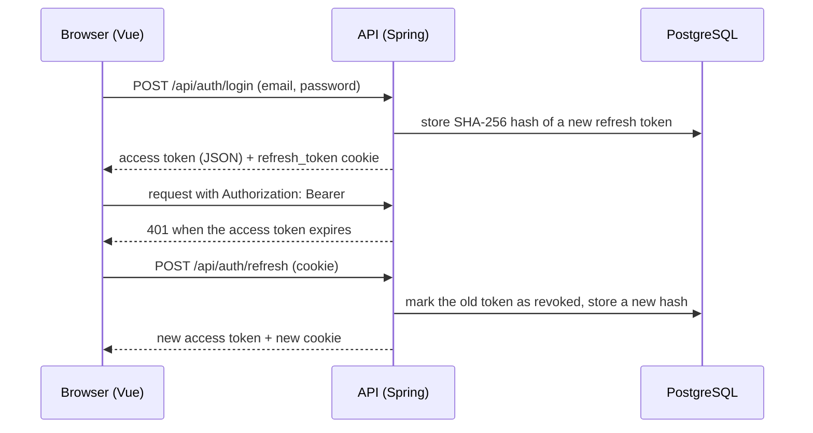

# 🥗 VittaDiet

**A meal and calorie tracker built with Java, Spring Boot and Vue 3. In development.**

Today the repository has a complete authentication flow, the database model for foods and meals, and the first screens of the web app.

🌐 **English** · [Português](README.pt-BR.md)

      

---

## 📌 About

VittaDiet is meant to let a person register meals, pick foods and quantities, and see calories, protein, carbohydrate and fat per item and per meal.

The project is **not finished**. What exists today:

- **Back end:** registration, login, token refresh and logout, with the security configuration around them.
- **Database:** Flyway migrations and JPA entities for users, weight logs, foods, personal foods, meals and meal items, including the nutrient calculation.
- **Front end:** landing page, login and registration screen, and an authenticated page that is still a placeholder.

What does **not** exist yet: the REST endpoints for meals, foods and weight logs, the import of the food table, and the dashboard that uses them. The request and response DTOs for meals and personal foods are already written, but no controller or service uses them.

## 📑 Table of Contents

- [Technologies](#-technologies)
- [Features](#-features)
- [The process](#-the-process)
- [What I learned](#-what-i-learned)
- [How can it be improved](#-how-can-it-be-improved)
- [Running the project](#-running-the-project)

---

## 🛠 Technologies

| Area | Technology |
| --- | --- |
| Language | Java 21 |
| Framework | Spring Boot 4.1.1 (Web MVC, Validation) |
| Security | Spring Security + `com.auth0:java-jwt` 4.6.1 |
| Database | PostgreSQL 16 (Docker Compose) |
| Persistence | Spring Data JPA + Hibernate |
| Migrations | Flyway |
| Build | Gradle |
| Tests | Spring Boot Test + Testcontainers |
| Front end | Vue 3, Vue Router, Vite 8, plain CSS |
| CI | GitHub Actions (back-end tests and front-end build) |

Lombok is used for getters and constructors. `commons-csv` and `pinia` are declared as dependencies but are not used by any code yet.

---

## 🚀 Features

### 🔐 Authentication

All endpoints are under `/api/auth` and are implemented in `AuthController`.

| Method | Endpoint | What it does |
| --- | --- | --- |
| `POST` | `/api/auth/register` | Creates a user. Returns `409` if the e-mail is already registered. |
| `POST` | `/api/auth/login` | Returns an access token and the username, and sets the `refresh_token` cookie. |
| `POST` | `/api/auth/refresh` | Exchanges the refresh cookie for a new access token and a new refresh cookie. |
| `POST` | `/api/auth/logout` | Revokes the refresh token and clears the cookie. |

- **Access token:** JWT signed with HMAC256, valid for 1 hour, sent in the `Authorization: Bearer` header.
- **Refresh token:** 32 random bytes, valid for 30 days. Only its SHA-256 hash is stored in the database.
- **Rotation:** each refresh token can be used once. If a token that was already used shows up again, every refresh token of that user is revoked.
- **Cookie:** `HttpOnly`, `Secure`, `SameSite=Strict`, limited to the path `/api/auth`.
- **Origin check:** `refresh` and `logout` reject requests whose `Origin` header is not the allowed front-end origin.
- **Passwords:** stored with BCrypt.
- **Roles:** `USER` and `ADMIN`, with the hierarchy `ADMIN > USER`.

Every other route requires authentication. The API is stateless and sends security headers (Content Security Policy, `X-Frame-Options`, HSTS, `Referrer-Policy`).

### 🧾 Error handling

`GlobalExceptionHandler` returns the same JSON shape for every error (`status`, `message` and, for validation errors, a `fields` map). Unexpected exceptions are logged and answered with a generic `500`, without internal details.

### 🗄 Data model

Ten Flyway migrations (`V1` to `V10`) create the schema:

| Table | Purpose |
| --- | --- |
| `users` | Account, role, height and gender |
| `weight_logs` | Weight entries of a user |
| `food` | Reference foods, identified by `taco_code`. A trigger blocks `UPDATE` and `DELETE`. |
| `personal_food` | Foods created by a user. The name is unique per user, ignoring case. |
| `meal` | A meal of a user, with period and time |
| `meal_item` | A food or a personal food plus a quantity in grams. A check constraint requires exactly one of the two. |
| `refresh_tokens` | Hashes of the refresh tokens, with expiration and revocation |

Meal periods are `CAFE_DA_MANHA`, `ALMOCO`, `LANCHE` and `JANTAR`.

### 🧮 Nutrient calculation

Nutrients are never stored per meal. `Nutrients` is a record with `plus` and `times`:

```
MealItem.nutrients()  = nutrients per 100 g × (quantityInGrams / 100)
Meal.totalNutrients() = sum of the nutrients of its items
```

This logic is in the entities and is not exposed by any endpoint yet.

### 🖥 Front end

| Route | Screen |
| --- | --- |
| `/` | Landing page |
| `/login` | Login and registration tabs, with field validation |
| `/app` | Authenticated page with empty panels (summary, goals, progress, recent meals) |

The access token is kept only in memory. A route guard protects `/app` and tries to restore the session from the refresh cookie after a page reload.

---

## 🔄 The process

The authentication flow was the first part to be built end to end, from the database to the browser.



### 1. Schema first

Every table is created by a Flyway migration, and Hibernate runs with `ddl-auto: validate` in the base configuration. Rules that must always hold were written in the database itself: check constraints, a unique index on `lower(name)` and the trigger that makes `food` read-only.

### 2. Two kinds of token

The access token is short-lived and never stored by the browser outside memory. The refresh token lives in a cookie that JavaScript cannot read, and the server keeps only its hash, so a copy of the database does not give usable tokens.

### 3. Same origin in development

Vite proxies `/api` to `http://localhost:8080`, so the browser only talks to `localhost:5173`. That is what allows a `SameSite=Strict` cookie to work during development.

### 4. Continuous integration

A GitHub Actions workflow runs `./gradlew test` (the test starts a PostgreSQL container with Testcontainers) and `npm run build` for the front end on every pull request and on pushes to `main`.

---

## 📚 What I learned

### Authentication with Spring Security

Writing a stateless filter chain, a `OncePerRequestFilter` that reads the JWT, and a `UserDetailsService` that loads users by e-mail. I also learned to configure a role hierarchy instead of repeating role checks.

### Refresh token rotation

Why a refresh token should be single-use, how to detect reuse, and why storing only a hash is safer than storing the token. I also learned what each cookie attribute (`HttpOnly`, `Secure`, `SameSite`, `Path`) protects against.

### Migrations and constraints

Using Flyway to version the schema and changing a table in a later migration instead of editing an old one. I learned to put rules such as "exactly one of `food_id` or `personal_food_id`" in a check constraint and to repeat the same rule in the DTO and in the entity.

### Validation and error responses

Using Bean Validation, including `@AssertTrue` for rules that involve more than one field, and centralizing error responses in a `@RestControllerAdvice` so the client always receives the same format.

### Modeling values

Representing nutrients as an immutable record with its own operations made the calculation of a meal a simple `reduce`, instead of four separate sums.

### Front-end session handling

Keeping the access token in memory, repeating a request once after a `401`, and using a shared promise and the Web Locks API so that only one refresh runs at a time.

### CI

Setting up a workflow with separate jobs for back end and front end, and using Testcontainers so the tests do not depend on a database installed on the machine.

---

## 🔮 How can it be improved

| Improvement | Description |
| --- | --- |
| **Meal and food endpoints** | Write the services and controllers for meals, personal foods and weight logs. The entities, repositories and DTOs already exist. |
| **Food import** | Import the reference food table from a CSV file. The `food` table and the `commons-csv` dependency are ready, the importer is not. |
| **Dashboard** | Replace the empty panels of `/app` with real data: daily summary, recent meals and progress. |
| **Fix the refresh path in the front end** | `core/api.js` calls `/auth/refresh`, but the API and the cookie use `/api/auth/refresh`, so the session is not restored after a reload. |
| **Fix `docker-compose.yaml`** | The first line (`services:`) is indented and Compose rejects the file. The health check also uses `{DB_USER}` instead of `${DB_USER}`. |
| **Tests** | The only test checks that the application context loads. Authentication and the nutrient calculation need their own tests. |
| **Development profile** | The `dev` profile sets `ddl-auto: update`, which can change the schema outside Flyway. It should stay on `validate`. |
| **Cleanup** | Remove the `System.out.println` in the main class, the unused `/api/users` rule and the unused dependencies. |
| **Deployment** | The front end has a `vercel.json`, but there is no deployment configuration for the API. |

---

## ▶ Running the project

### Requirements

- Java 21
- Docker (for PostgreSQL and for the tests)
- Node.js `^22.18.0` or `>=24.12.0`
- Git

### 1. Clone the repository

```bash
git clone https://github.com/G-Delboni/VittaDiet.git
cd VittaDiet
```

### 2. Configure the environment

Copy `.env.example` to `.env` and fill in the values. Never commit the `.env` file.

```
DB_USER=
DB_PASSWORD=
DB_NAME=
POSTGRES_PORT=5433
SECRET=
```

`SECRET` is the key used to sign the JWT. Docker Compose and Spring both read this file. `APP_ALLOWED_ORIGIN` is optional and defaults to `http://localhost:5173`.

### 3. Start the database

```bash
docker compose up -d
```

As committed, this command fails with `services must be a mapping`. Remove the two spaces before `services:` on the first line of `docker-compose.yaml` and run it again.

### 4. Run the API

```bash
./gradlew bootRun
```

On Windows:

```bash
gradlew.bat bootRun
```

The API will be available at `http://localhost:8080`. Flyway creates the tables on startup.

### 5. Run the front end

```bash
cd frontend
npm install
npm run dev
```

The app will be available at `http://localhost:5173`.

### 6. Try it

```bash
curl -X POST http://localhost:8080/api/auth/register \
  -H "Content-Type: application/json" \
  -d '{"username":"maria","email":"maria@example.com","password":"change-me-123","height":165,"userGender":"FEMALE"}'
```

```bash
curl -i -X POST http://localhost:8080/api/auth/login \
  -H "Content-Type: application/json" \
  -d '{"email":"maria@example.com","password":"change-me-123"}'
```

### Running the tests

```bash
./gradlew test
```

Docker must be running, because the test starts a PostgreSQL container.

---

Built by **Gabriel Delboni Dias** ·
[LinkedIn](https://www.linkedin.com/in/gabriel-delboni-dias/) ·
[GitHub](https://github.com/G-Delboni)
