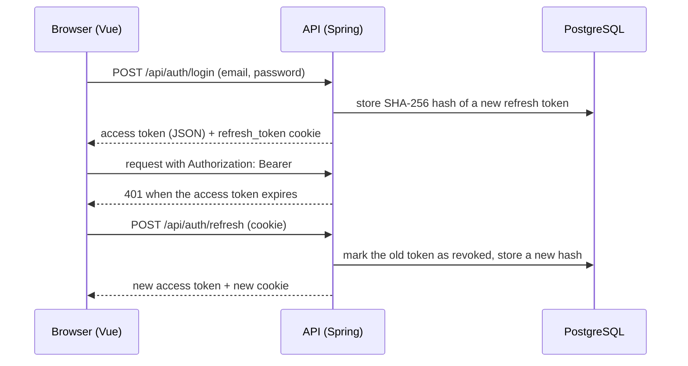

# 🥗 VittaDiet

**Um registro de refeições e calorias feito com Java, Spring Boot e Vue 3. Em desenvolvimento.**

Hoje o repositório tem o fluxo de autenticação completo, o modelo de banco para alimentos e refeições e as primeiras telas da aplicação web.

🌐 [English](README.md) · **Português**

      

---

## 📌 Sobre

O VittaDiet foi pensado para que uma pessoa registre refeições, escolha alimentos e quantidades e veja calorias, proteína, carboidrato e gordura por item e por refeição.

O projeto **não está pronto**. O que existe hoje:

- **Back-end:** cadastro, login, renovação de token e logout, com a configuração de segurança em volta deles.
- **Banco de dados:** migrações Flyway e entidades JPA para usuários, registros de peso, alimentos, alimentos pessoais, refeições e itens de refeição, incluindo o cálculo de nutrientes.
- **Front-end:** página inicial, tela de login e cadastro e uma página autenticada que ainda é um espaço reservado.

O que **ainda não** existe: os endpoints REST de refeições, alimentos e registros de peso, a importação da tabela de alimentos e o painel que usa esses dados. Os DTOs de requisição e resposta de refeições e alimentos pessoais já estão escritos, mas nenhum controller ou service os utiliza.

## 📑 Sumário

- [Tecnologias](#-tecnologias)
- [Funcionalidades](#-funcionalidades)
- [O processo](#-o-processo)
- [O que aprendi](#-o-que-aprendi)
- [Como pode melhorar](#-como-pode-melhorar)
- [Como rodar o projeto](#-como-rodar-o-projeto)

---

## 🛠 Tecnologias

| Área | Tecnologia |
| --- | --- |
| Linguagem | Java 21 |
| Framework | Spring Boot 4.1.1 (Web MVC, Validation) |
| Segurança | Spring Security + `com.auth0:java-jwt` 4.6.1 |
| Banco de dados | PostgreSQL 16 (Docker Compose) |
| Persistência | Spring Data JPA + Hibernate |
| Migrações | Flyway |
| Build | Gradle |
| Testes | Spring Boot Test + Testcontainers |
| Front-end | Vue 3, Vue Router, Vite 8, CSS puro |
| CI | GitHub Actions (testes do back-end e build do front-end) |

O Lombok é usado para getters e construtores. `commons-csv` e `pinia` estão declarados como dependências, mas ainda não são usados por nenhum código.

---

## 🚀 Funcionalidades

### 🔐 Autenticação

Todos os endpoints ficam em `/api/auth` e estão implementados no `AuthController`.

| Método | Endpoint | O que faz |
| --- | --- | --- |
| `POST` | `/api/auth/register` | Cria um usuário. Retorna `409` se o e-mail já estiver cadastrado. |
| `POST` | `/api/auth/login` | Retorna um access token e o nome de usuário e define o cookie `refresh_token`. |
| `POST` | `/api/auth/refresh` | Troca o cookie de refresh por um novo access token e um novo cookie de refresh. |
| `POST` | `/api/auth/logout` | Revoga o refresh token e apaga o cookie. |

- **Access token:** JWT assinado com HMAC256, válido por 1 hora, enviado no cabeçalho `Authorization: Bearer`.
- **Refresh token:** 32 bytes aleatórios, válido por 30 dias. Só o hash SHA-256 dele é guardado no banco.
- **Rotação:** cada refresh token pode ser usado uma vez. Se um token já usado aparecer de novo, todos os refresh tokens daquele usuário são revogados.
- **Cookie:** `HttpOnly`, `Secure`, `SameSite=Strict`, limitado ao caminho `/api/auth`.
- **Verificação de origem:** `refresh` e `logout` rejeitam requisições cujo cabeçalho `Origin` não seja a origem permitida do front-end.
- **Senhas:** armazenadas com BCrypt.
- **Papéis:** `USER` e `ADMIN`, com a hierarquia `ADMIN > USER`.

Todas as outras rotas exigem autenticação. A API é stateless e envia cabeçalhos de segurança (Content Security Policy, `X-Frame-Options`, HSTS, `Referrer-Policy`).

### 🧾 Tratamento de erros

O `GlobalExceptionHandler` devolve o mesmo formato JSON para todos os erros (`status`, `message` e, nos erros de validação, um mapa `fields`). Exceções inesperadas são registradas em log e respondidas com um `500` genérico, sem detalhes internos.

### 🗄 Modelo de dados

Dez migrações Flyway (`V1` a `V10`) criam o esquema:

| Tabela | Finalidade |
| --- | --- |
| `users` | Conta, papel, altura e gênero |
| `weight_logs` | Registros de peso de um usuário |
| `food` | Alimentos de referência, identificados por `taco_code`. Uma trigger bloqueia `UPDATE` e `DELETE`. |
| `personal_food` | Alimentos criados por um usuário. O nome é único por usuário, sem diferenciar maiúsculas de minúsculas. |
| `meal` | Uma refeição de um usuário, com período e horário |
| `meal_item` | Um alimento ou um alimento pessoal mais uma quantidade em gramas. Uma check constraint exige exatamente um dos dois. |
| `refresh_tokens` | Hashes dos refresh tokens, com expiração e revogação |

Os períodos de refeição são `CAFE_DA_MANHA`, `ALMOCO`, `LANCHE` e `JANTAR`.

### 🧮 Cálculo de nutrientes

Os nutrientes nunca são armazenados por refeição. `Nutrients` é um record com `plus` e `times`:

```
MealItem.nutrients()  = nutrients per 100 g × (quantityInGrams / 100)
Meal.totalNutrients() = sum of the nutrients of its items
```

Essa lógica está nas entidades e ainda não é exposta por nenhum endpoint.

### 🖥 Front-end

| Rota | Tela |
| --- | --- |
| `/` | Página inicial |
| `/login` | Abas de login e cadastro, com validação dos campos |
| `/app` | Página autenticada com painéis vazios (resumo, metas, progresso, refeições recentes) |

O access token fica apenas em memória. Um guard de rota protege `/app` e tenta recuperar a sessão pelo cookie de refresh depois de um recarregamento da página.

---

## 🔄 O processo

O fluxo de autenticação foi a primeira parte construída de ponta a ponta, do banco de dados ao navegador.



### 1. Esquema primeiro

Toda tabela é criada por uma migração Flyway, e o Hibernate roda com `ddl-auto: validate` na configuração base. As regras que precisam valer sempre foram escritas no próprio banco: check constraints, um índice único em `lower(name)` e a trigger que torna `food` somente leitura.

### 2. Dois tipos de token

O access token dura pouco e nunca é guardado pelo navegador fora da memória. O refresh token fica em um cookie que o JavaScript não consegue ler, e o servidor guarda apenas o hash dele, então uma cópia do banco não entrega tokens utilizáveis.

### 3. Mesma origem em desenvolvimento

O Vite faz proxy de `/api` para `http://localhost:8080`, então o navegador só conversa com `localhost:5173`. É isso que permite um cookie `SameSite=Strict` funcionar durante o desenvolvimento.

### 4. Integração contínua

Um workflow do GitHub Actions roda `./gradlew test` (o teste sobe um container PostgreSQL com Testcontainers) e `npm run build` para o front-end a cada pull request e a cada push na `main`.

---

## 📚 O que aprendi

### Autenticação com Spring Security

Escrever uma cadeia de filtros stateless, um `OncePerRequestFilter` que lê o JWT e um `UserDetailsService` que carrega usuários pelo e-mail. Também aprendi a configurar uma hierarquia de papéis em vez de repetir verificações de papel.

### Rotação de refresh token

Por que um refresh token deve ser de uso único, como detectar reuso e por que guardar só o hash é mais seguro do que guardar o token. Também aprendi contra o que cada atributo do cookie (`HttpOnly`, `Secure`, `SameSite`, `Path`) protege.

### Migrações e constraints

Usar o Flyway para versionar o esquema e alterar uma tabela em uma migração posterior em vez de editar uma antiga. Aprendi a colocar regras como "exatamente um entre `food_id` e `personal_food_id`" em uma check constraint e a repetir a mesma regra no DTO e na entidade.

### Validação e respostas de erro

Usar Bean Validation, incluindo `@AssertTrue` para regras que envolvem mais de um campo, e centralizar as respostas de erro em um `@RestControllerAdvice` para que o cliente receba sempre o mesmo formato.

### Modelagem de valores

Representar nutrientes como um record imutável com suas próprias operações transformou o cálculo de uma refeição em um `reduce` simples, em vez de quatro somas separadas.

### Sessão no front-end

Manter o access token em memória, repetir uma requisição uma vez depois de um `401` e usar uma promise compartilhada e a Web Locks API para que só uma renovação rode por vez.

### CI

Montar um workflow com jobs separados para back-end e front-end e usar Testcontainers para que os testes não dependam de um banco instalado na máquina.

---

## 🔮 Como pode melhorar

| Melhoria | Descrição |
| --- | --- |
| **Endpoints de refeições e alimentos** | Escrever os services e controllers de refeições, alimentos pessoais e registros de peso. As entidades, os repositórios e os DTOs já existem. |
| **Importação de alimentos** | Importar a tabela de alimentos de referência a partir de um arquivo CSV. A tabela `food` e a dependência `commons-csv` estão prontas, o importador não. |
| **Painel** | Substituir os painéis vazios de `/app` por dados reais: resumo do dia, refeições recentes e progresso. |
| **Corrigir o caminho do refresh no front-end** | `core/api.js` chama `/auth/refresh`, mas a API e o cookie usam `/api/auth/refresh`, então a sessão não é recuperada depois de um recarregamento. |
| **Corrigir o `docker-compose.yaml`** | A primeira linha (`services:`) está indentada e o Compose rejeita o arquivo. O health check também usa `{DB_USER}` em vez de `${DB_USER}`. |
| **Testes** | O único teste verifica se o contexto da aplicação sobe. A autenticação e o cálculo de nutrientes precisam de testes próprios. |
| **Perfil de desenvolvimento** | O perfil `dev` define `ddl-auto: update`, que pode alterar o esquema por fora do Flyway. O ideal é manter `validate`. |
| **Limpeza** | Remover o `System.out.println` da classe principal, a regra de `/api/users` que não é usada e as dependências sem uso. |
| **Deploy** | O front-end tem um `vercel.json`, mas não há configuração de deploy para a API. |

---

## ▶ Como rodar o projeto

### Requisitos

- Java 21
- Docker (para o PostgreSQL e para os testes)
- Node.js `^22.18.0` ou `>=24.12.0`
- Git

### 1. Clonar o repositório

```bash
git clone https://github.com/G-Delboni/VittaDiet.git
cd VittaDiet
```

### 2. Configurar o ambiente

Copie `.env.example` para `.env` e preencha os valores. Nunca faça commit do arquivo `.env`.

```
DB_USER=
DB_PASSWORD=
DB_NAME=
POSTGRES_PORT=5433
SECRET=
```

`SECRET` é a chave usada para assinar o JWT. O Docker Compose e o Spring leem esse mesmo arquivo. `APP_ALLOWED_ORIGIN` é opcional e tem como padrão `http://localhost:5173`.

### 3. Subir o banco de dados

```bash
docker compose up -d
```

Do jeito que está no repositório, esse comando falha com `services must be a mapping`. Remova os dois espaços antes de `services:` na primeira linha do `docker-compose.yaml` e rode de novo.

### 4. Rodar a API

```bash
./gradlew bootRun
```

No Windows:

```bash
gradlew.bat bootRun
```

A API ficará disponível em `http://localhost:8080`. O Flyway cria as tabelas na inicialização.

### 5. Rodar o front-end

```bash
cd frontend
npm install
npm run dev
```

A aplicação ficará disponível em `http://localhost:5173`.

### 6. Testar

```bash
curl -X POST http://localhost:8080/api/auth/register \
  -H "Content-Type: application/json" \
  -d '{"username":"maria","email":"maria@example.com","password":"change-me-123","height":165,"userGender":"FEMALE"}'
```

```bash
curl -i -X POST http://localhost:8080/api/auth/login \
  -H "Content-Type: application/json" \
  -d '{"email":"maria@example.com","password":"change-me-123"}'
```

### Rodando os testes

```bash
./gradlew test
```

O Docker precisa estar em execução, porque o teste sobe um container PostgreSQL.

---

Feito por **Gabriel Delboni Dias** ·
[LinkedIn](https://www.linkedin.com/in/gabriel-delboni-dias/) ·
[GitHub](https://github.com/G-Delboni)
